# Cum trimit un newsletter

Ghid pas cu pas pentru cine trimite newsletterele Bioscem. Durează cam 10–15 minute.
Pozele sunt făcute pe un site de probă, cu abonați și produse inventate.

Totul se face din **Admin → Email-uri → Newslettere**.

---

## Înainte de primul newsletter (o singură dată)

- Cere programatorului să-ți confirme că **trimiterea automată (cronul)** merge și că
  **serverul de email (SMTP)** e setat. Lista de verificare din pasul 3 îți spune oricum dacă
  ceva lipsește.
- Uită-te în **Liste abonați**: abonații de pe site ajung singuri în lista „Toți abonații”.

---

## 1. Creezi newsletterul

Apasă **+ Newsletter nou**. Butonul **?** de lângă titlu explică pe scurt ce înseamnă stările
(Ciornă, Programat, Se trimite, Oprit, Trimis).

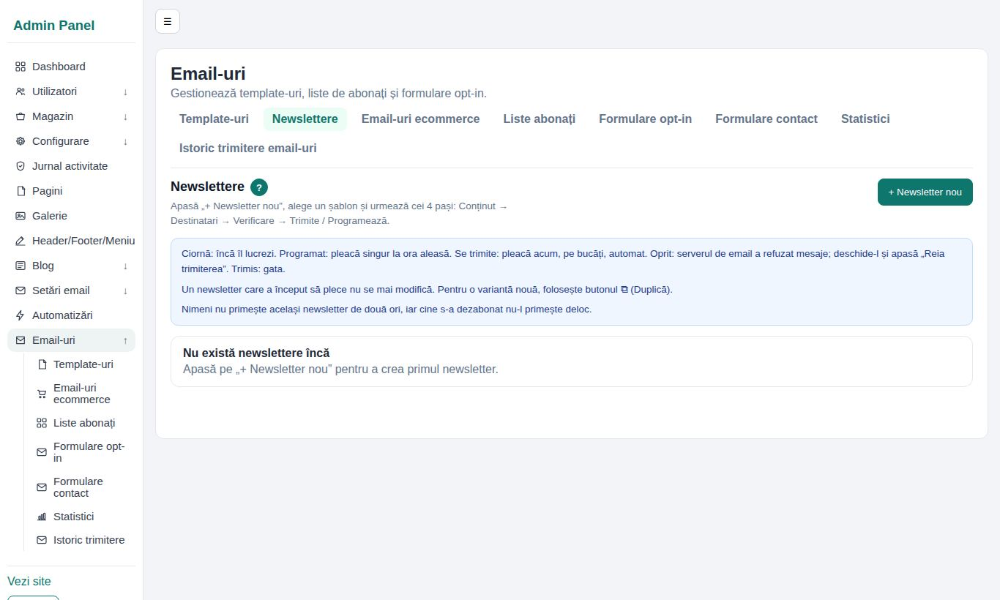

Completezi:

- **Nume newsletter**: doar pentru tine (de exemplu „Noutăți noiembrie”);
- **Subiect**: ce văd abonații în inbox (de exemplu „Noutăți de toamnă de la Bioscem”);
- **Listă abonați**: o poți schimba mai târziu.

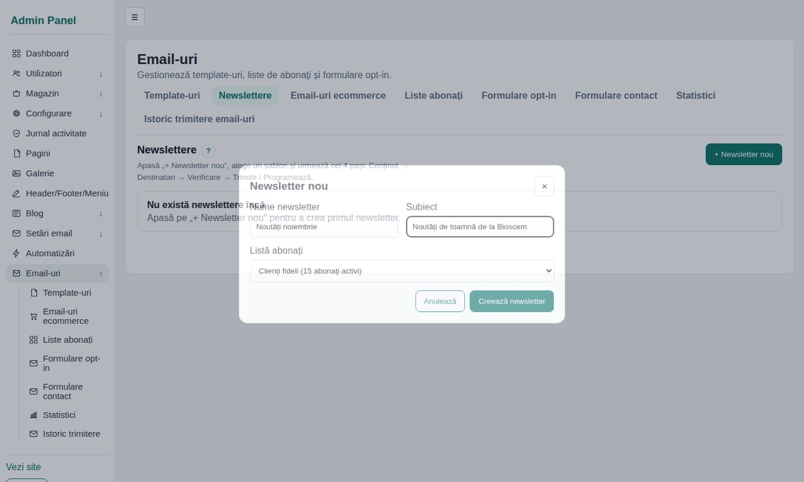

Apasă **Creează newsletter**.

## 2. Alegi un șablon

Se deschide fereastra **Alege un șablon**. Primele patru au logo-ul, culorile și produsele
magazinului:

- **Noutăți și produse**: un mesaj scurt și 4 produse;
- **Ofertă / reducere**: titlu mare, un cod de cupon, produse în ofertă;
- **Sfat / articol**: un sfat, un citat și un link spre blog;
- **Anunț scurt**: pentru vești rapide (program de sărbători, livrare gratuită).

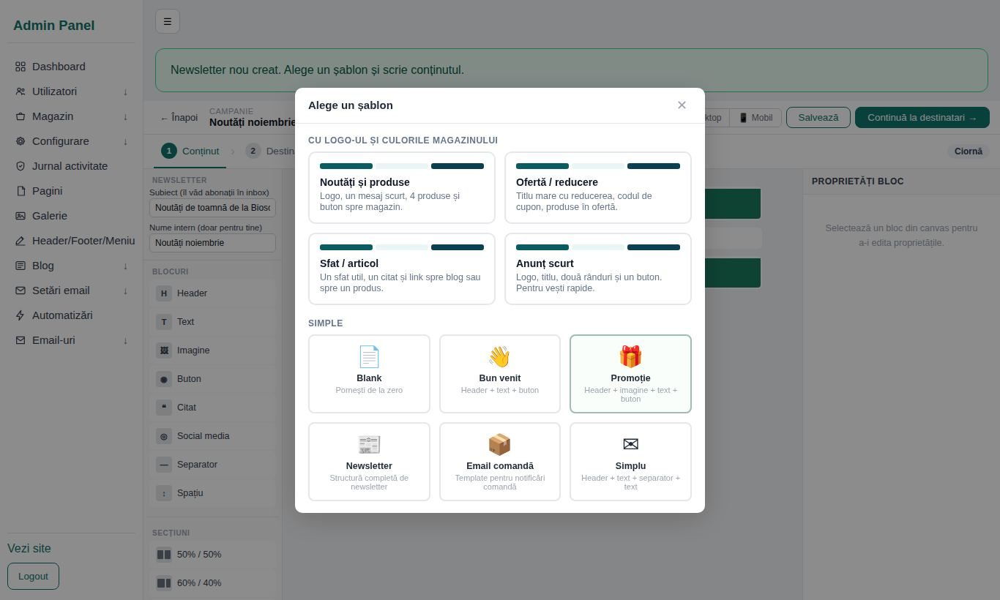

Linkul „Dezabonează-mă” **nu** e în șablon: se pune singur, jos, în fiecare email trimis.

## 3. Pasul „Conținut”: scrii textul

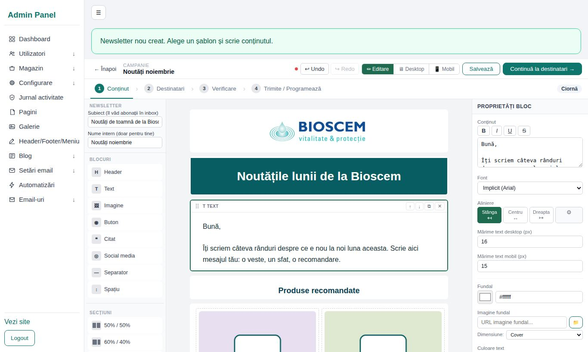

- Sus în stânga: **Subiect** și **Nume intern**.
- **Dai clic pe un bloc** (titlu, text, poză, buton) și îl modifici în dreapta, la
  „Proprietăți bloc”.
- **Poze**: la un bloc „Imagine” apeși pe 📁 și alegi din galerie.
- **Butoane**: scrii textul butonului și adresa la care duce (de exemplu
  `https://bioscem.ro/magazin`). Un buton fără adresă e semnalat la verificare.
- **Produsele** din șablon sunt cele mai noi produse din magazin. Le poți schimba (poza,
  numele, prețul și linkul) sau șterge (✕ pe bloc).
- Adaugi blocuri trăgându-le din stânga. **Undo** anulează ultima modificare.
- **Înlocuiește toate textele de exemplu** („Scrie aici…”, „TOAMNA20”, „Titlul anunțului”).
  Verificarea îți arată dacă a rămas vreunul.

Apasă **Continuă la destinatari →**. Newsletterul se salvează singur când treci la pasul
următor (poți apăsa și **Salvează** oricând).

## 4. Pasul „Destinatari”: cui trimiți

Bifezi una sau mai multe liste. Jos vezi **câți abonați** îl vor primi. Cine e în mai multe
liste îl primește o singură dată, iar cine s-a dezabonat nu-l primește deloc.

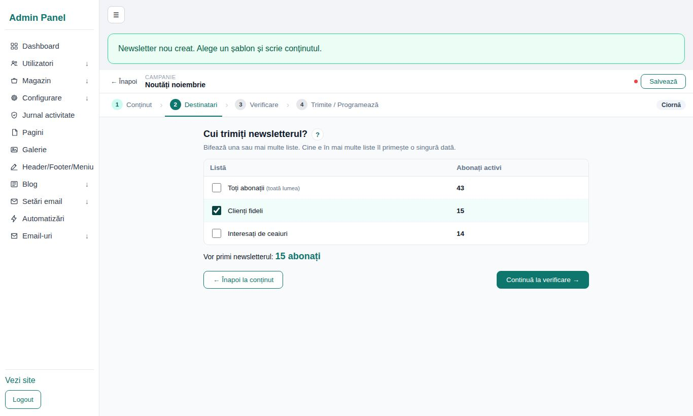

Apasă **Continuă la verificare →**.

## 5. Pasul „Verificare”: te uiți înainte să trimiți

În stânga vezi newsletterul exact cum îl vor primi oamenii. Apasă **Telefon** ca să-l vezi cum
arată pe mobil (majoritatea îl citesc pe telefon).

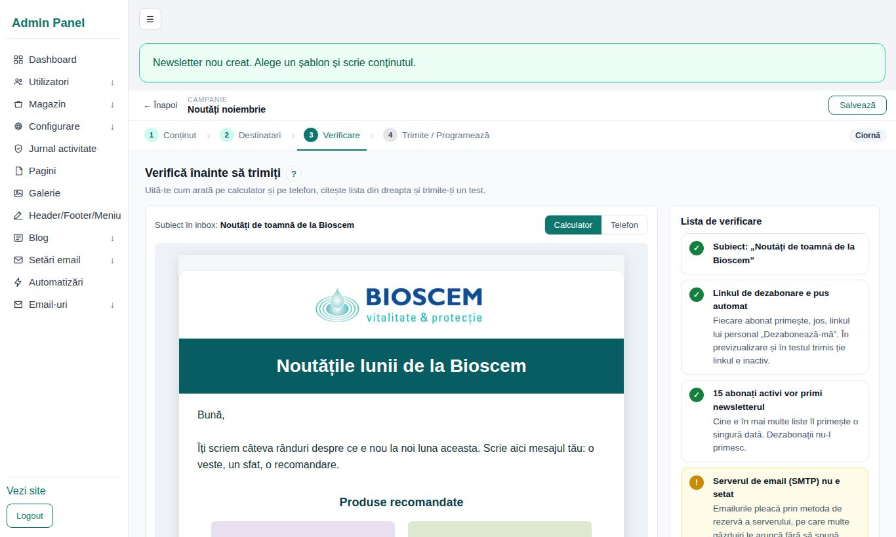

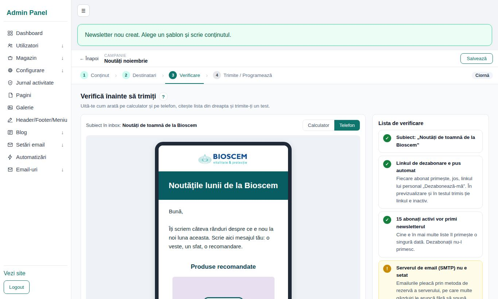

În dreapta e **lista de verificare**:

- ✓ **verde**: în regulă;
- **!** **galben**: merită o privire, dar poți trimite;
- ✕ **roșu**: trebuie reparat. Cât timp e ceva roșu, butoanele de trimitere sunt blocate.

Exemple de puncte roșii: un buton fără adresă, o poză ștearsă din galerie, niciun abonat ales,
subiect gol.

**Trimite-ți un test**: scrii adresa ta în „Trimite un test” și apeși butonul. Deschide emailul
pe telefon și apasă pe fiecare buton. Testul nu ajunge la abonați și nu apare în statistici.

## 6. Pasul „Trimite / Programează”

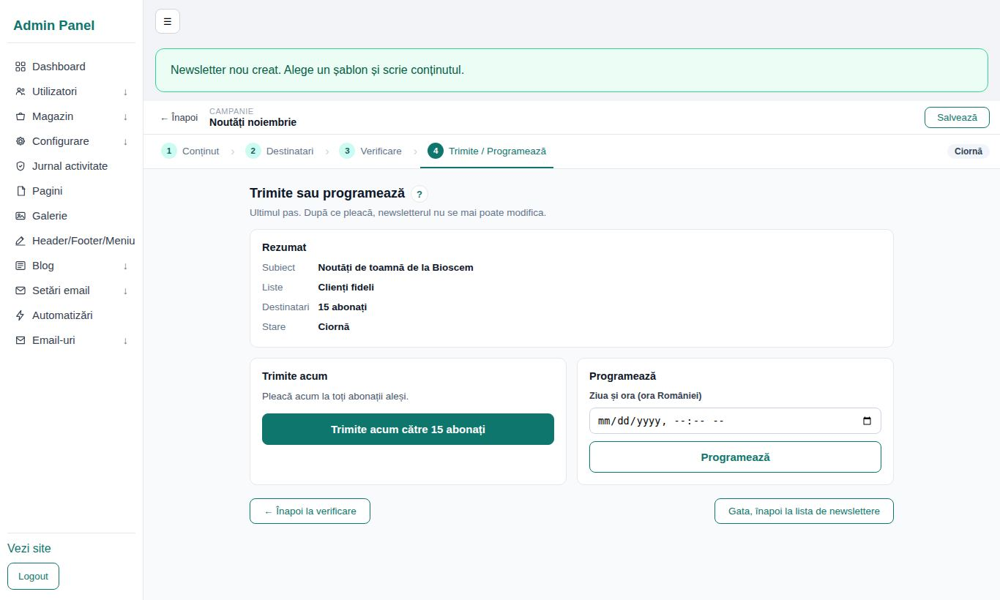

- **Trimite acum**: te mai întreabă o dată („Trimiți … către 15 abonați?”). Primele emailuri
  pleacă imediat, restul automat, în câteva minute. Poți închide pagina.
- **Programează**: alegi ziua și ora (ora României) și apeși **Programează**. Pleacă singur la
  ora aceea (în cel mult 5 minute după). Până atunci îl poți modifica sau poți apăsa
  **Anulează programarea**.

La o listă mare, newsletterul pleacă pe bucăți, în câteva minute. Cât timp pleacă vezi cât a
plecat; poți închide pagina.

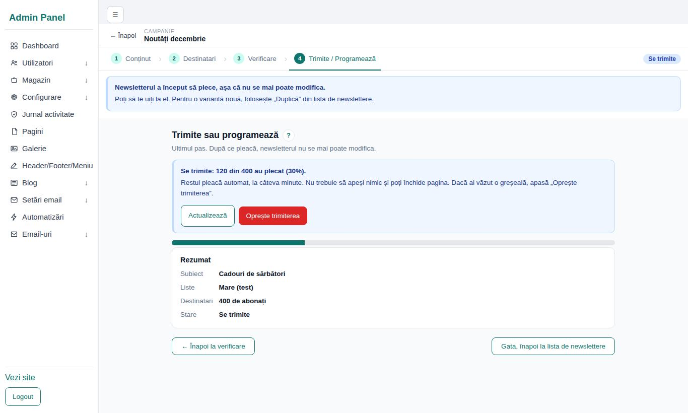

Când a plecat tot, vezi asta:

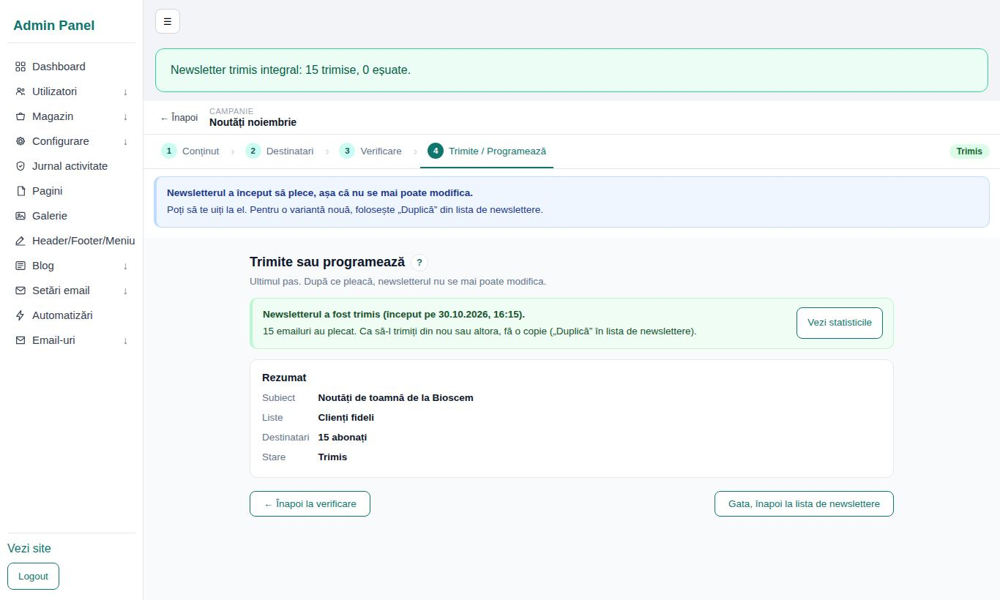

## 7. Vezi rezultatele

**Statistici** (sau butonul „Vezi statisticile”):

- **Oameni care au deschis** și **oameni care au dat clic** (fiecare om numărat o dată);
- **Venituri atribuite**: comenzile plasate în cel mult 7 zile după un clic din newsletter;
- ce linkuri au fost apăsate și lista destinatarilor.

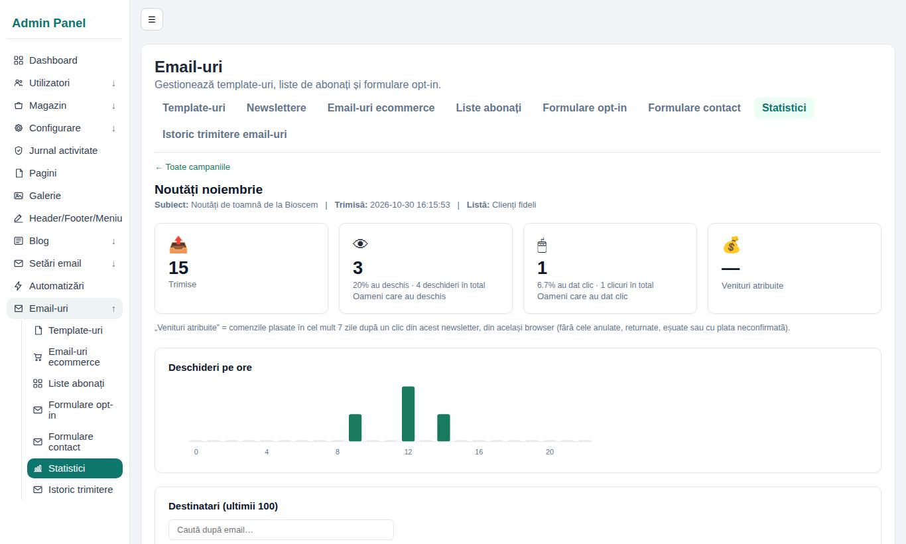

Deschiderile nu sunt exacte: unele programe de email nu încarcă pozele (deci nu se numără), iar
altele le încarcă singure. Clicurile și comenzile sunt mai sigure.

---

## Dacă ceva nu merge

**Starea „Oprit” și mesajul roșu „Trimiterea s-a oprit”.** Serverul de email a refuzat mai
multe mesaje la rând (parolă schimbată, limită de trimitere atinsă). Trimiterea s-a oprit
singură, ca să nu se piardă toată lista. Spune-i programatorului mesajul afișat. După ce e
reparat, deschizi newsletterul și apeși **Reia trimiterea**. Cei care l-au primit deja nu-l
primesc a doua oară.

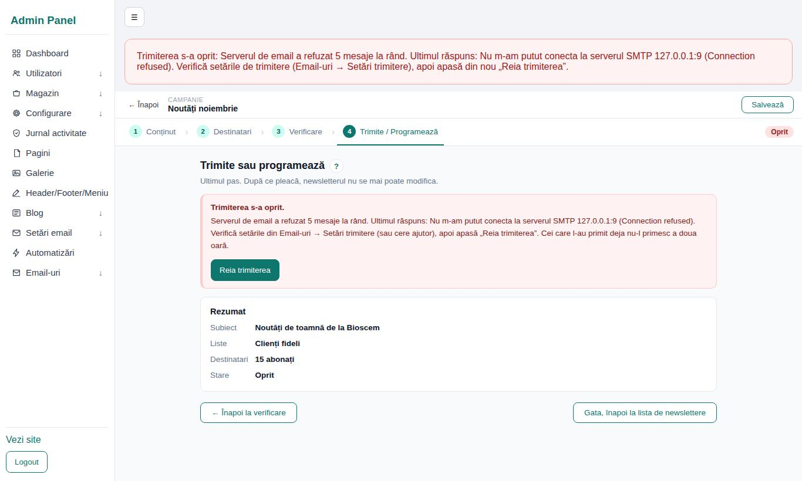

**Am văzut o greșeală după ce am apăsat „Trimite acum”.** Deschide newsletterul și apasă
**Oprește trimiterea** (butonul roșu). Se oprește în câteva secunde. Cine l-a primit deja
rămâne așa; ceilalți îl primesc doar dacă apeși **Reia trimiterea**. Pentru o variantă
corectată, folosește **Duplică** și trimite copia. Atenție: copia pleacă la toată lista,
deci și la cei care au primit deja varianta greșită.

**„Trimiterea automată (cronul) nu a mai rulat”** în lista de verificare. Programările nu
pleacă. Anunță programatorul.

**Vreau să schimb ceva după ce a plecat.** Nu se mai poate (unii l-ar primi într-un fel, alții
altfel). În lista de newslettere apeși ⧉ (**Duplică**), modifici copia și o trimiți.

**Vreau să-l trimit și celor care s-au abonat între timp.** Tot cu **Duplică**: copia pleacă
la toată lista, deci și la cei care l-au primit deja. Gândește-te dacă merită.

**Cineva vrea să nu mai primească.** Linkul „Dezabonează-mă” din email deschide o pagină cu
butonul **Confirm dezabonarea**; după ce îl apasă, gata. Excepție: linkurile din
newsletterele trimise **înainte de actualizarea din noiembrie 2026** deschid o pagină cu
butonul **Trimite-mi linkul de dezabonare pe email**; omul primește pe email un link nou și
se dezabonează de acolo (așa nu poate dezabona altcineva în locul lui). Dacă îți scrie direct, îl cauți în
**Liste abonați** și apeși ⟲. Dacă cere să-i ștergi datele, apeși 🗑 (vezi mai jos, „Lista
«nu trimite»”).

---

## Cum se abonează oamenii (dubla confirmare)

Cine se înscrie din formularul de pe site **nu e abonat imediat**. Primește un email „Mai e un
singur pas” și devine abonat doar după ce apasă **Confirm abonarea** (din email, apoi pe pagina
care se deschide). Așa nimeni nu poate abona adresa altcuiva.

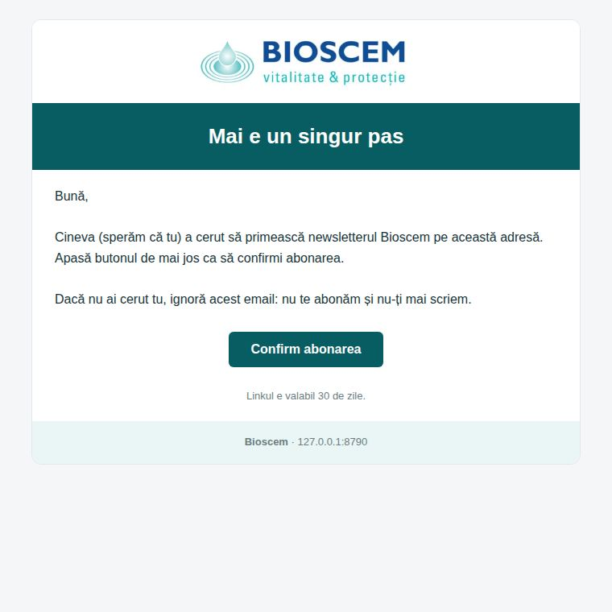

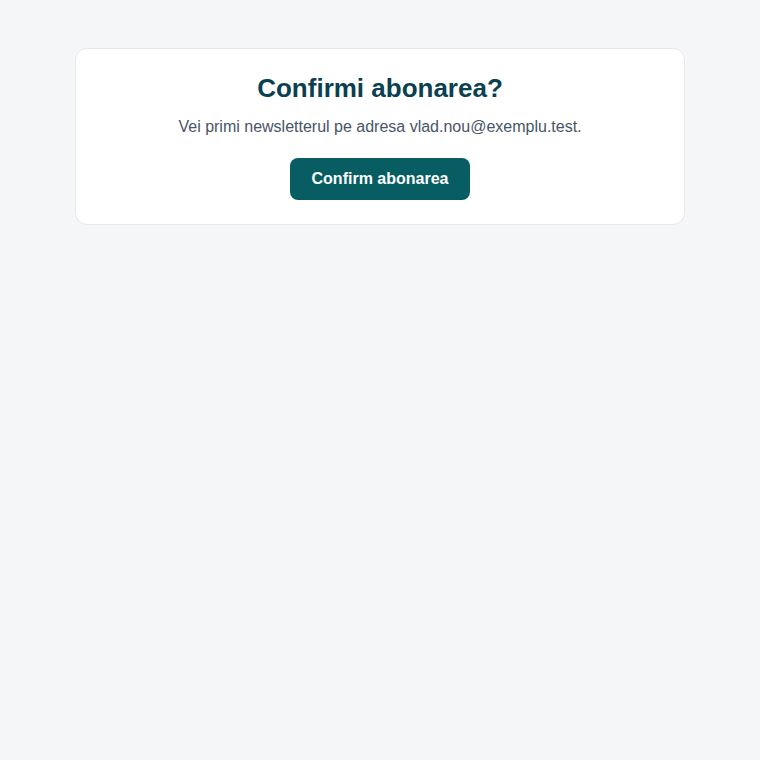

- Până confirmă, în **Liste abonați** apare ca **neconfirmat** și nu primește newslettere.
  Nu-l poți confirma tu în locul lui.
- Linkul e valabil **30 de zile**. Cererile neconfirmate se șterg singure după 30 de zile.
- Aceeași adresă primește cel mult un email de confirmare la 5 minute (3 pe zi), de pe
  aceeași conexiune se pot face cel mult 20 de cereri pe oră, iar pe tot site-ul pleacă cel
  mult 300 de emailuri de confirmare pe oră: formularul nu poate fi folosit ca să umple
  inboxul cuiva. Dacă se atinge limita de 300, în **Liste abonați** și în **Statistici** apare o notă
  galbenă: dacă nu ai o campanie mare de înscrieri, spune-i programatorului (poate fi un atac).
- Cine se dezabonase și se reabonează din formular rămâne dezabonat până apasă linkul.
- Adresele adăugate de tine în **Liste abonați** sau din import sunt active imediat, ca
  înainte: adaugă-le doar dacă omul și-a dat acordul (în magazin, pe hârtie, la telefon).

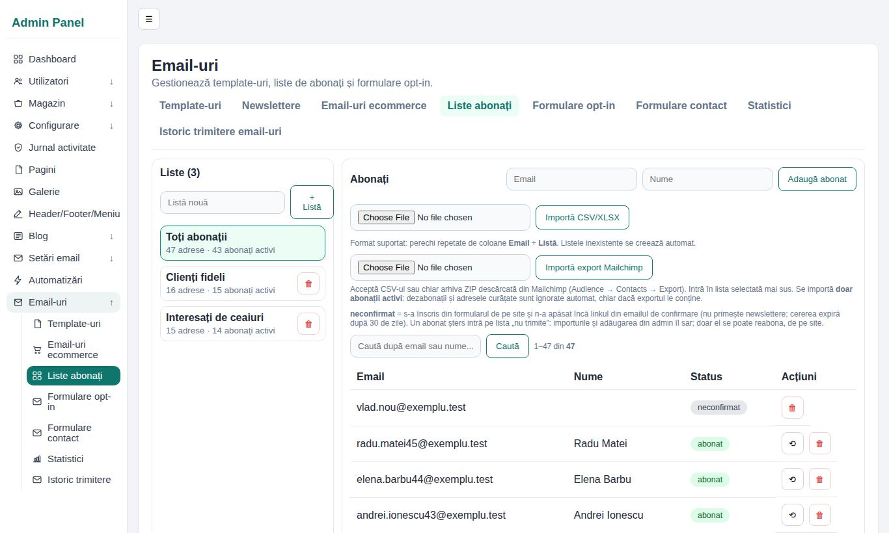

## Lista „nu trimite” (abonați șterși)

Când ștergi un abonat (🗑 în **Liste abonați**), adresa lui intră pe lista „nu trimite”:

- nu mai poate fi adăugată din admin și e sărită la orice import (CSV, Mailchimp, backup
  WordPress); mesajul de după import spune câte adrese au fost sărite;
- singurul mod în care revine: persoana se abonează **singură** din formularul de pe site și
  confirmă din email.

Ce păstrăm (GDPR): **doar amprenta adresei** (un cod calculat din ea, SHA-256), nu adresa
însăși și nimic altceva. O păstrăm doar ca să respectăm cererea omului de a nu mai primi
emailuri; din amprentă nu se poate citi adresa, se poate doar verifica dacă o adresă dată e
pe listă. În **Statistici** vezi câte adrese sunt pe listă.

---

## Reguli (GDPR și bun-simț)

- Trimite doar celor care s-au abonat. **Nu importa adrese** din altă parte (clienți vechi,
  cărți de vizită) fără acordul lor.
- Cine cere să nu mai primească nimic sau să-i ștergi datele: îl ștergi (🗑). Adresa intră pe
  lista „nu trimite” și nu mai revine din greșeală, la un import.
- **Nu reactiva** pe cineva care s-a dezabonat, decât dacă ți-a cerut-o explicit, în scris.
  Adminul te întreabă de fiecare dată.
- Cel mult un newsletter pe săptămână. Prea multe aduc dezabonări și ajung în Spam.
- Subiect scurt și concret, fără MAJUSCULE și fără „!!!”.
